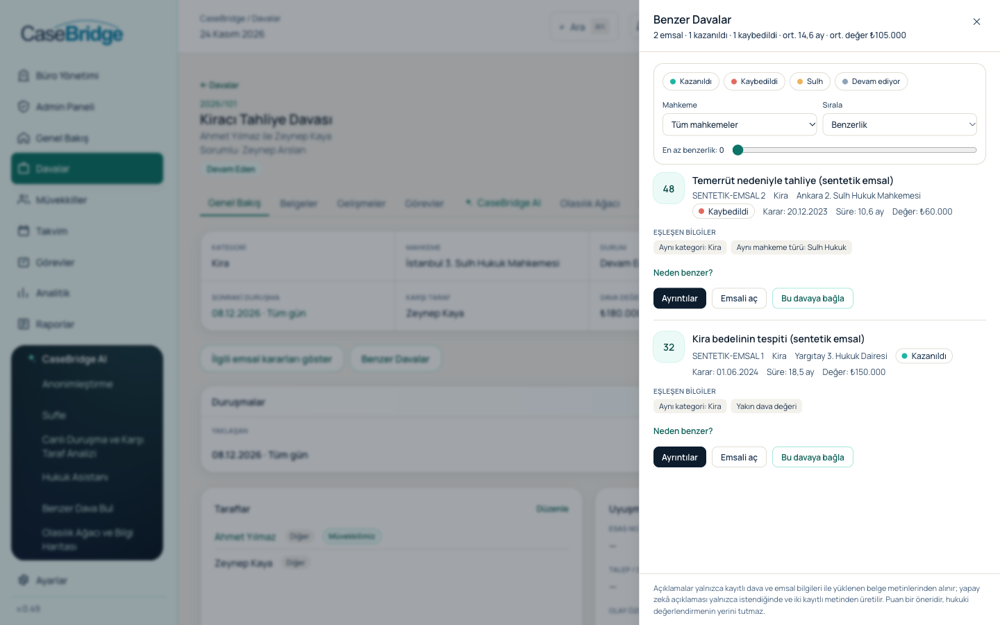
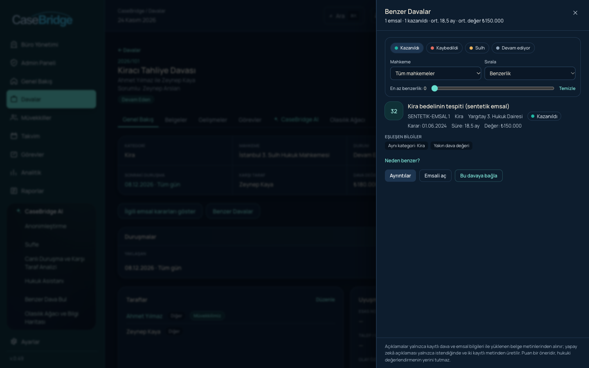
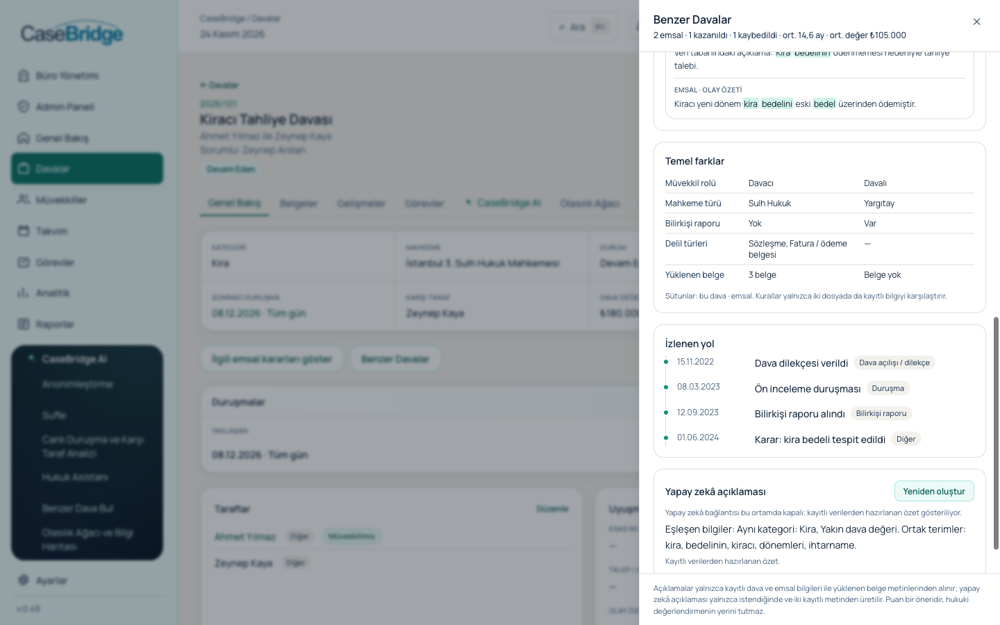
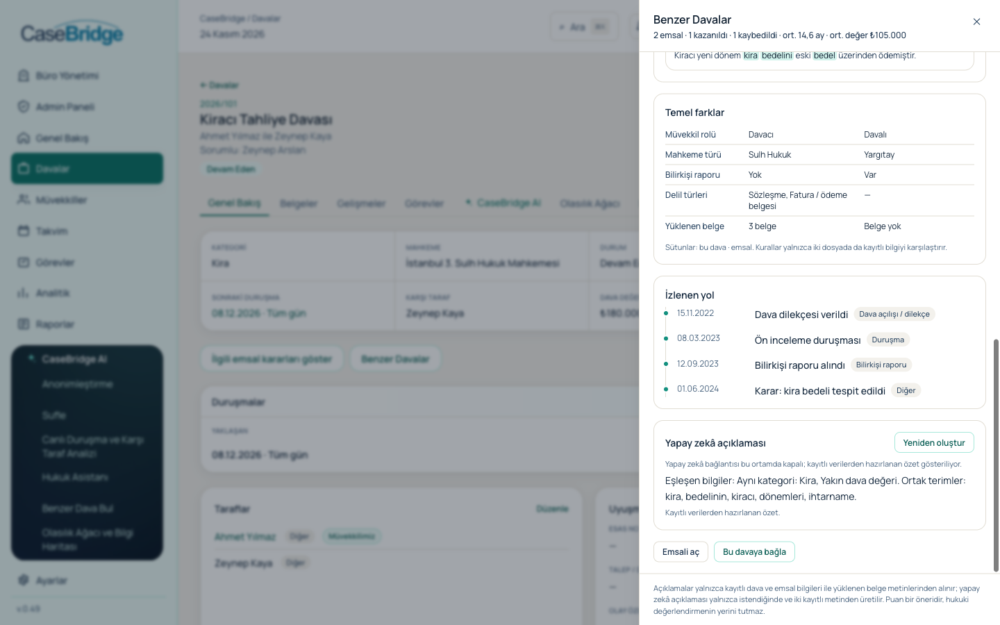
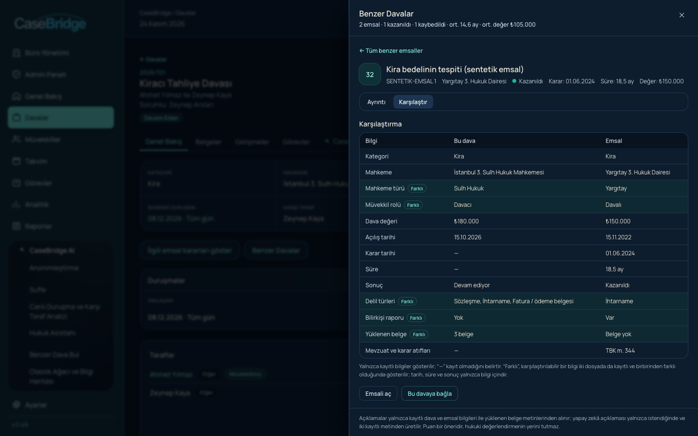
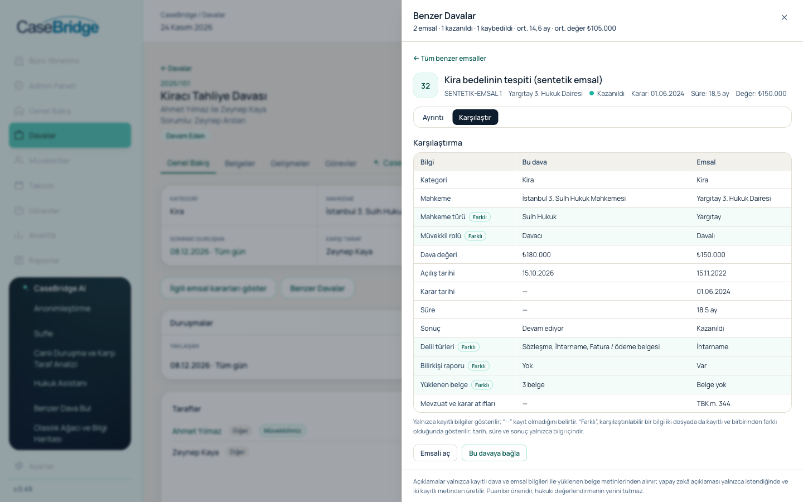
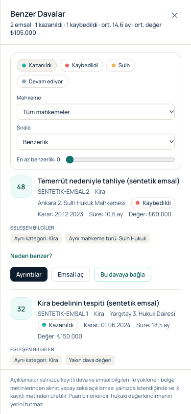
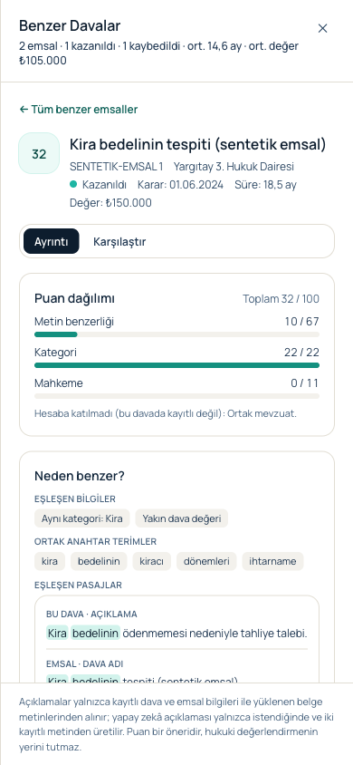

# Benzer Davalar: similar precedents report

Branch `feat/similar-cases`, application v.0.49 (unreleased, not pushed). Spec: `specs/019-similar-precedents`, change record: `specs/changes/similar-precedents.json`. Date: 24 Nov 2026.

## What it does

On the case page, the "Benzer Davalar" button opens a right-hand drawer. It lists the bureau's own precedents ranked against the open case. For each precedent it explains why the two are similar, how they differ, and the path the precedent followed. All of this comes from stored data. An AI explanation is shown only when the user asks for one.

- **Stage 1 (backend engine):** a pure-Python hybrid score with extractive explanations. It uses shared terms, shared statute and Yargıtay references, matching fields and highlighted passage pairs.
- **Stage 2 (sidebar):** the ranked list, "Neden benzer?", "Emsali aç", and linking or unlinking a precedent.
- **Stage 3 (this round):**
  - Filters and a summary.
  - Value and duration for each precedent.
  - Score breakdown.
  - Rule-based key differences.
  - Timeline ("İzlenen yol").
  - Side-by-side comparison.
  - Optional AI explanation with a timeout and a fallback.

## Score formula

```
score = 100 × Σ(wᵢ · vᵢ) / Σ(wᵢ over the signals the case can provide)

text      w = 0.6   v = TF-IDF cosine of the two texts (pure Python)
case_type w = 0.2   v = 1 if the category is the same
court     w = 0.1   v = 1 same court or court type, 0.5 same family (e.g. Sulh/Asliye Hukuk), else 0
statutes  w = 0.1   v = share of the case's statute/decision references found in the precedent
```

- **What counts as text:** case_name, claim, facts_summary, plaintiff_position, defendant_position, description and closing_note, plus up to 8,000 characters of extracted document text.
- **Turkish normalisation:**
  - Lower-casing handles dotted and dotless I (İ/ı).
  - Letters are folded to plain ASCII.
  - Stopwords are removed.
  - Up to two suffixes are trimmed. A stem keeps at least 4 letters, and a one-letter suffix is trimmed only as the last one.
- **Statute and decision references:** taken by regular expressions:
  - Code articles: "TBK 49", "İİK m. 67", "HMK md. 107", "TBK'nın 344. maddesi".
  - Numbered laws: "4857 sayılı … Kanunu'nun 18. maddesi".
  - Yargıtay decisions: "Yargıtay … E. … K.", in either order.
- **Missing signals:** if the case has no court, no references or no text, that signal is left out of the denominator. It does not count as a miss.
- **Listing rule:** a precedent is listed only if its cosine is at least 0.05 or it has the same category.
- **Score breakdown:** `score_breakdown` gives each signal's points and its maximum. The points add up to the score, give or take rounding.
- **Cache:** the precedent corpus is cached in memory for each bureau. The cache key changes when any precedent or precedent document changes, and entries also expire after 300 seconds.

## Endpoint contract

`GET /cases/{case_id}/similar-precedents`

| Query | Type | Default | Notes |
|---|---|---|---|
| `limit` | 1–20 | 5 | Number of items. The summary always covers every filtered match. |
| `outcome` | repeatable `won`/`lost`/`settled`/`ongoing` | all | An unknown value returns 422. |
| `court` | string ≤255 | all | Exact court name, compared case-insensitively with Turkish rules. |
| `min_score` | 0–100 | 0 | Applied to the rounded score. |
| `precedent_id` | string | — | Narrows the result to one precedent. The sidebar's AI button uses it. |
| `explain` | bool | false | Adds `ai_explanation` to each returned item. |

**Response:**

```jsonc
{
  "summary": { "count": 12, "outcomes": {"won": 8, "lost": 3, "settled": 1},
               "avg_duration_months": 14.0, "duration_count": 10,
               "avg_case_value": 250000.0, "value_count": 9,
               "available_courts": ["…"], "excluded_signals": ["Ortak mevzuat"] },
  "source": { /* FactsOut of the open case */ },
  "items": [{
    "precedent_id": "…", "case_number": "…", "case_name": "…", "case_type": "kira", "court": "…",
    "outcome": "won", "decision_date": "2024-06-01", "score": 74, "text_score": 58, "linked_to_case": false,
    "explanation": { "shared_terms": [], "shared_statutes": [], "matching_fields": [], "passages": [] },
    "case_value": 100000.0, "duration_months": 14.0,
    "score_breakdown": [{"key": "text", "label": "Metin benzerliği", "points": 35.0, "max_points": 60.0}],
    "key_differences": [{"label": "Müvekkil rolü", "case_value": "Davacı", "precedent_value": "Davalı"}],
    "timeline": [{"event_date": "2023-01-10", "event_type": "filing", "title": "Dava açıldı"}],
    "facts": { "case_type": "kira", "court": "…", "court_type": "Sulh Hukuk", "client_role": "defendant",
               "case_value": 100000.0, "opening_date": "…", "decision_date": "…", "duration_months": 14.0,
               "outcome": "won", "evidence": ["Bilirkişi raporu"], "has_expert_report": true,
               "document_count": 1, "statutes": ["TBK m. 344"] },
    "ai_explanation": null   // or {"status": "ai"|"fallback", "text": "…", "notice": "…"|null}
  }]
}
```

**Fields:**

- **`duration_months`:** months from `opening_date` to `decision_date`, to one decimal. It is null unless both dates are stored and in order.
- **Averages:** each average uses only the rows that store the value, and the response gives that row count alongside. When no row stores it, the average is null.
- **`timeline`:** the precedent's CaseEvents for the same bureau, ordered by date, at most 25.

**`key_differences` rules:** a rule fires only when both files store the fact. The rules cover:

- Category.
- Client role.
- Court type.
- Expert report: an `expert_report` event, or the phrase in the text.
- Evidence families named in the text: witness, contract, notice, invoice or payment receipt, messages, photos, on-site inspection, minutes, medical report, payroll/SGK, land registry.
- Whether documents are uploaded.
- Case values more than 2× apart.

**Access:**

| Request | Result |
|---|---|
| No login | 401 |
| Restricted workspace account | 403 |
| Another bureau's case, a precedent ID, or an unknown ID | 404 |
| `limit`, `min_score` or `outcome` out of range | 422 |

- Every query filters by `law_firm_id`. This covers precedents, documents, events, document counts and links.

**AI explanation (`explain=true`):**

- **Prompt:** the system prompt carries the no-fabrication clause from `app/ai/agents/common.py`. The user prompt holds only the two stored texts and the extractive explanation.
- **Execution:** task level `similarity.explain` (basic). Calls run in a 4-worker thread pool with a total deadline of `SIMILARITY_EXPLAIN_TIMEOUT_SECONDS` (default 12).
- **Fallback:** an extractive Turkish summary with a notice replaces the AI text in any of these cases:
  - The deadline passes.
  - The provider fails.
  - The answer is empty.
  - AI is off (`LLM_PROVIDER=mock` or no key).
  - The answer cites a statute or decision that is in neither text.
- **Never blocks:** the request still returns 200. The sidebar list never asks for an explanation; only the button does, for one precedent.

## UI

- **Header:** a summary line, e.g. "12 emsal · 8 kazanıldı · 3 kaybedildi · 1 sulh · ort. 14 ay · ort. değer ₺250.000".
- **Filters:**
  - Outcome chips.
  - Court select. Its options come from the unfiltered list, so a filter can always be changed back.
  - Minimum-similarity slider, applied after a 250 ms pause.
  - "Temizle" resets all filters.
- **Sort:** done in the browser by similarity, decision date, duration or value. Missing values go last.
- **Cards:** score, category, court, outcome, decision date, duration, amount, "Bağlı" chip, matching fields and statutes, "Neden benzer?", "Ayrıntılar", "Emsali aç", and link/unlink.
- **Detail view ("Ayrıntılar"):**
  - Score breakdown bars, with a note naming any signal left out.
  - "Neden benzer?" (terms, statutes, highlighted passage pairs).
  - "Temel farklar".
  - "İzlenen yol": a vertical timeline in the style of the Gelişmeler timeline (CaseTimelinePanel).
  - "Yapay zekâ açıklaması": button with idle, loading, answer, fallback-notice and error states.
- **"Karşılaştır" mode:** a table with this case and the precedent side by side.
  - Comparable facts are marked "Farklı" when both files store them and they differ.
  - Dates, duration and outcome are shown for reference only and never marked, because they differ between any two files.
- **Theme and layout:** works in light and dark themes and at 390 px phone width. The panel is full width on mobile, 520 px on desktop and 720 px in compare mode.

Screenshots (local demo, synthetic precedents, `artifacts/similar-cases/`):

| | |
|---|---|
| List with summary and filters (light) |  |
| Outcome filter applied (dark) |  |
| Detail: breakdown, differences, timeline, AI fallback (light) |  |
| Detail scrolled to timeline (light) |  |
| Compare mode (dark / light) |   |
| Mobile 390 px (list / detail) |   |

## Test results (24 Nov 2026, local)

See `specs/019-similar-precedents/verification.md` for the recorded numbers.

- **Backend, new tests:** `tests/api/test_similar_precedents_details.py` has 14 tests, all using MockProvider. They cover:
  - Summary.
  - Averages that are null without data.
  - The outcome, court and min_score filters, and 422 on bad values.
  - The limit applying to items but not to the summary.
  - Value, duration, breakdown, timeline and differences.
  - Firm isolation, including another bureau's event rows and precedent IDs.
  - Explain off by default.
  - A prompt containing only the two texts.
  - The timeout, error, empty, ungrounded-citation and AI-off fallbacks.
  - Mock mode.
- **Backend, existing tests:** the 13 stage 1–2 tests were adapted to `{items}`.
- **Full backend suite on SQLite:** 1249 passed, 1 skipped (NER model not installed), 1 xfailed (pre-existing), exit 0.
- **PostgreSQL 16:** the 36 similarity tests (stages 1–3 plus the stage-1 similar-cases tests) passed.
- **Frontend:** `tsc` is clean. Vitest passes 96 files / 854 tests, including 13 sidebar tests for filters, sort, detail, compare and AI loading/answer/fallback/error. `next build` succeeds.
- **Spec checks:** `check-specs.py` and `check-spec-changes.py` both pass.

## Decisions

1. **Response shape:** the endpoint returns `{summary, source, items}`, and the stage-2 list shape was not kept. Only the sidebar used it and it was never released. The stage-1 `/cases/{id}/similar` endpoint is unchanged. The new query parameters are optional, and with defaults the results are the same as before.
2. **Summary scope:** the summary covers all filtered matches, not just the first `limit`. The header says "ilk N gösteriliyor" when it shows fewer, and the sidebar requests 20.
3. **Outcome wording:** the summary uses the app's outcome labels ("kazanıldı / kaybedildi / sulh") rather than "kabul / ret". The stored outcome is the bureau's result, not the court's verdict wording.
4. **Duration:** measured in months from `opening_date` to `decision_date`. Ongoing precedents have no duration and are left out of the average.
5. **Evidence and document types:** `Document.file_type` is only pdf/docx/txt, so evidence types come from evidence families named in the stored text. Expert reports also come from `expert_report` events. Uploaded documents count as present or absent.
6. **AI explanation scope:** it is requested for one precedent through `precedent_id` and is never part of the list request. That keeps the main response free of LLM latency. With `explain=true` and no `precedent_id`, every returned item is explained under one shared deadline.
7. **Mock mode:** with `LLM_PROVIDER=mock` the explanation is the extractive fallback with a notice. The default mock text is placeholder JSON, which would look like a real answer.
8. **Grounding check:** any statute or decision reference in the AI answer must appear in one of the two texts. Otherwise the answer is rejected.
9. **Old card kept:** the "Benzer davalar" card on the case overview stays. It lists ordinary same-bureau cases as well as precedents and links to the full search page; the precedent-only sidebar does not cover either.
10. **Version:** stays v.0.49. The manifest hash was refreshed and its version reset after `next build`/`next dev` bumped it.

## Limits

- **PostgreSQL:** only the similarity tests ran there, not the full suite. They ran on a local PostgreSQL 16 because no Docker daemon was available.
- **Demo data:** the demo seed has no precedents. The browser check used three synthetic precedents with synthetic events in a scratch database.
- **Evidence detection:** keyword-based. A word that is negated or used in passing still counts, e.g. "tanık dinlenmedi" still counts as witness evidence.
- **Court types:** the "Yargıtay" court type comes from the court name. Comparing a first-instance court with Yargıtay is marked as a difference on purpose.
- **Cache refresh:** editing a precedent document's extracted text without a new upload refreshes the corpus only after the 300-second time-to-live.
- **Timeout thread:** when the deadline passes, the pool thread keeps running until the provider's own timeout. The pool has 4 workers, so a slow provider can queue later explanations.
- **AI grounding:** the check covers statute and decision references only. It cannot verify free-text claims; the prompt and the "doğrulama gerektirir" note handle those.

## Stage 3 ideas (next)

- Store a per-precedent "decision summary" field so explanations and differences can use the holding, not only the facts.
- Show outcome-weighted statistics for the filtered set, such as success rate by court type, with clear sample sizes.
- Precompute document evidence families at upload time so the corpus build does not rescan text.
- Mark an "Ders çıkarılacak nokta" note on a precedent from the sidebar and show it in later comparisons.
- Export the comparison table to the case's notes or a PDF.
- Run the full backend suite on PostgreSQL in CI.
